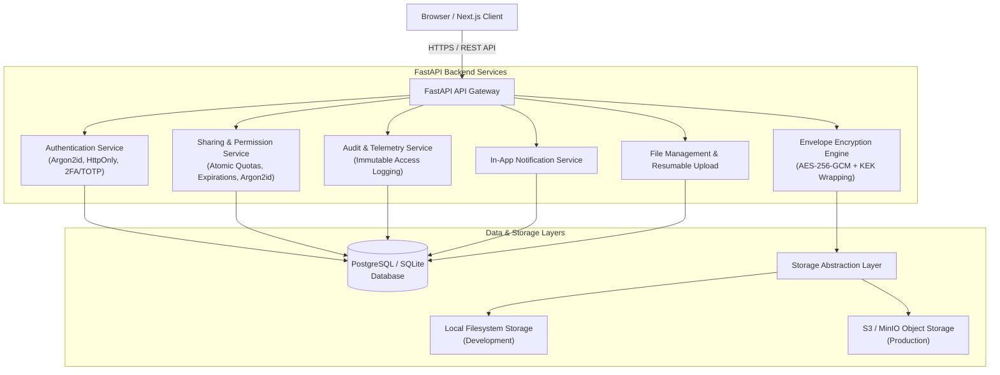

# SecureShare — Secure File Sharing & Encrypted Document Transfer Platform

[](https://github.com/secureshare/secureshare/actions)
[](https://www.python.org/)
[](https://fastapi.tiangolo.com/)
[](https://nextjs.org/)
[](https://www.postgresql.org/)
[](https://csrc.nist.gov/publications/detail/sp/800-38d/final)
[](https://www.rfc-editor.org/rfc/rfc9106.html)
[](LICENSE)

> **"Your Files. Your Privacy. Your Control."**  
> A commercial-grade, deterministic, **100% Non-AI** secure file sharing and encrypted document transfer platform engineered for high-assurance data privacy, authenticated envelope encryption, granular access control, and comprehensive auditability.

---

## Architecture Overview



---

## Key Features

- **Authenticated AEAD File Encryption**: Every upload is encrypted with **AES-256-GCM** using a cryptographically random 256-bit Data Encryption Key (DEK) and a unique 96-bit nonce. Tampered or modified ciphertext is immediately rejected by 128-bit authentication tags.
- **Envelope Key Wrapping**: Raw DEKs are envelope-wrapped under a master Key Encryption Key (KEK) using domain-separated Additional Associated Data (AAD). Secret keys are never persisted in plaintext, written to database records, or logged.
- **Revocable High-Entropy Share Links**: 32-byte cryptographic random URL-safe tokens with zero-knowledge database persistence (only `SHA-256(token)` is stored).
- **Argon2id Password Protection**: Share links and user credentials are protected by memory-hard Argon2id hashing with rate limiting and brute-force mitigation.
- **Strict Server-Side Expirations**: Configurable lifetimes (1h, 24h, 7d, 30d, custom) evaluated on every request.
- **Atomic Concurrency-Safe Download Limits**: Atomic SQL update queries prevent race conditions or simultaneous requests from exceeding download caps.
- **Granular Role-Based Access Control (RBAC)**: Grant `OWNER`, `EDITOR`, or `VIEWER` roles to specific collaborator emails.
- **Comprehensive Audit Trail & Telemetry**: Immutable logging of all uploads, views, downloads, denied access attempts, IP addresses, and failure diagnostics.
- **Two-Factor Authentication (TOTP)**: RFC 6238 compliant authenticator app pairing with emergency single-use recovery codes.
- **Instant One-Click Demo Mode**: Front-page live demo session button allows immediate exploration with zero signup friction.
- **Dual Storage Abstraction**: Seamlessly switch between local disk storage and S3-compatible private object storage (AWS S3, MinIO, Cloudflare R2).
- **100% Non-AI / Zero Telemetry**: Deterministic cybersecurity architecture with no third-party analytics, model training, or document parsing.

---

## Technology Stack

| Layer | Technology | Details |
|---|---|---|
| **Frontend** | Next.js 16 (App Router), React 19, TypeScript | Standalone production output, Tailwind CSS, Lucide Icons |
| **Backend** | Python 3.12, FastAPI, Pydantic | High-performance asynchronous REST API, OpenAPI 3.0 |
| **Database** | PostgreSQL 16 (or SQLite for local dev) | SQLAlchemy 2.0 ORM, Alembic migration revisions |
| **Cryptography** | AES-256-GCM, Argon2id, SHA-256 | `cryptography` primitives, envelope encryption hierarchy |
| **Storage** | Local Filesystem & S3 / MinIO | Pluggable storage abstraction with random 64-char hex keys |
| **DevOps** | Docker, Docker Compose, GitHub Actions | Multi-stage Dockerfiles, automated CI test runner |

---

## Cryptographic Envelope Workflow

```
[Plaintext Upload] ──> SHA-256 Checksum Computed
       │
       ▼
 1. Generate random 256-bit DEK & unique 96-bit Nonce
 2. AES-256-GCM encrypt file with AAD="secureshare:file:v1"
 3. Wrap DEK under 256-bit master KEK with AAD="secureshare:key:v1"
       │
       ├──────────────────────────────────────────┐
       ▼                                          ▼
 [Encrypted Object]                      [Wrapped DEK Envelope]
 Stored in Object Storage                Stored in Database File Record
 (Local Disk or S3 / MinIO)              (Never exposes raw secret key)
```

Upon download:
1. The backend unwrap-verifies the DEK using the server's master KEK.
2. The file is decrypted and verified against the 128-bit authentication tag.
3. The plaintext SHA-256 hash is verified against the original checksum before streaming.

---

## Quick Start (Local Development)

### 1. Clone & Configure
```bash
git clone https://github.com/secureshare/secureshare.git
cd secureshare
cp .env.example .env
```

### 2. Backend Setup
```bash
cd backend
python -m venv .venv
source .venv/bin/activate  # On Windows: .venv\Scripts\activate
pip install -r requirements.txt pytest

# Apply database migrations
python -m alembic upgrade head

# Start FastAPI API server
uvicorn app.main:app --reload --host 127.0.0.1 --port 8000
```
API Documentation: `http://localhost:8000/docs`

### 3. Frontend Setup
In a new terminal:
```bash
cd frontend
npm install
npm run dev
```
Open your browser to: `http://localhost:3000`

### 4. Instant Demo Mode
On `http://localhost:3000`, click **"Live Demo"** in the top navigation or **"Try Live Demo (No Signup)"** on the landing page to enter the workspace instantly.

---

## Docker Compose Setup

Run the entire platform including PostgreSQL, MinIO, FastAPI Backend, and Next.js Frontend with one command:

```bash
docker compose up -d --build
```

- **Frontend**: `http://localhost:3000`
- **FastAPI API & OpenAPI Docs**: `http://localhost:8000/docs`
- **MinIO S3 Console**: `http://localhost:9001` (User: `minioadmin`, Pass: `minioadminpassword`)
- **PostgreSQL**: `localhost:5432`

To shut down:
```bash
docker compose down
```

---

## Automated Test Suite

SecureShare includes 28 automated tests covering authentication, cryptographic round-trips, tamper resistance, concurrency, and access control.

To run the test suite:
```bash
pytest backend/tests
```

### Test Coverage Highlights
- **Cryptographic Round-Trip**: Validates encrypt-decrypt accuracy and confirms unique 96-bit nonces per operation.
- **Tamper Resistance**: Proves that modifying any bit in the ciphertext or nonce causes immediate decryption failure.
- **Key Isolation**: Verifies that raw secret keys never appear in API responses or logs.
- **Concurrency & Quotas**: Simulates concurrent download requests to ensure atomic limits are never exceeded.
- **Access Control & Permissions**: Tests owner vs collaborator permissions (`VIEWER`, `EDITOR`), grant revocation, and expiration rejection.

---

## Documentation Index

- [System Architecture](docs/architecture.md): Modular component breakdown and sequence flows.
- [Database Schema](docs/database.md): Entity-relationship diagrams and table specifications.
- [REST API Reference](docs/api.md): Endpoints, request/response schemas, and status codes.
- [Cryptographic Specification](docs/encryption.md): AES-256-GCM, KEK envelope encryption, and nonces.
- [Security Model](docs/security.md): Threat model, Argon2id hashing, and abuse prevention.
- [Production Deployment](docs/deployment.md): Instructions for Vercel, Render, Railway, and AWS.
- [Local Development](docs/local-development.md): Native execution and testing setup.

---

## License

This project is licensed under the MIT License.
