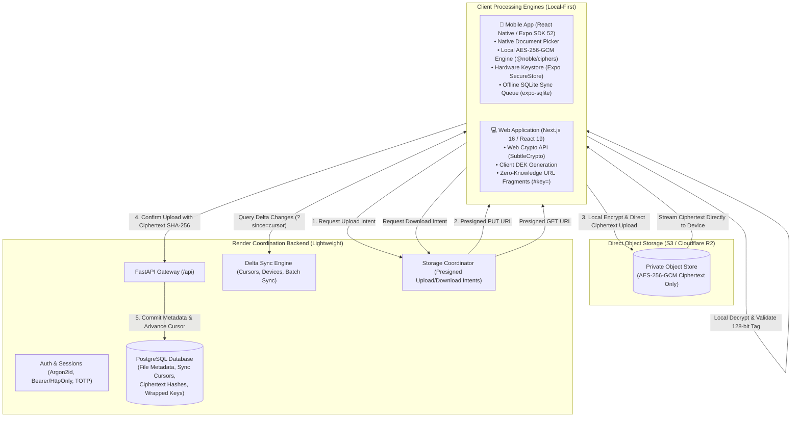

# SecureShare — Device-Powered Zero-Knowledge Secure File Platform

[](https://github.com/durveshk01/File-Sharing/releases/latest)
[](https://github.com/durveshk01/File-Sharing/releases/download/v1.0.0/app-release.apk)
[](https://github.com/durveshk01/File-Sharing/actions)
[](https://fastapi.tiangolo.com/)
[](https://nextjs.org/)
[](https://expo.dev/)
[](https://csrc.nist.gov/publications/detail/sp/800-38d/final)
[](https://www.rfc-editor.org/rfc/rfc9106.html)
[](LICENSE)

> **"Your Files. Your Privacy. Processed on Your Device."**  
> SecureShare is a commercial-grade, **zero-knowledge, mobile-first** secure file-sharing and encrypted synchronization platform. All heavy cryptographic operations—file reading, AES-256-GCM encryption, SHA-256 integrity hashing, and decryption—are executed **exclusively on the user's client device**. Render acts strictly as a lightweight metadata index, authentication gateway, and synchronization coordinator.

📱 **Download Latest Android APK**: [**`app-release.apk` (v1.0.0)**](https://github.com/durveshk01/File-Sharing/releases/download/v1.0.0/app-release.apk)  
🌐 **Live Web Application**: [**https://frontend-five-fawn-27.vercel.app**](https://frontend-five-fawn-27.vercel.app)  
📦 **GitHub Release**: [**SecureShare v1.0.0 Release Notes**](https://github.com/durveshk01/File-Sharing/releases/tag/v1.0.0)

---

## Architecture Overview



---

## Core Principles & Innovations

### 1. Device-Powered Cryptography (Zero-Knowledge)
- **Zero Server Plaintext Processing**: Neither Render nor any backend service ever receives, stores, or sees unencrypted file contents or raw Data Encryption Keys (DEKs).
- **Client-Side AES-256-GCM**: Files are encrypted with random 256-bit DEKs and unique 96-bit nonces directly inside the mobile app or browser before network transmission.
- **Client-Side SHA-256 Hashing**: Integrity hashes of both plaintext and ciphertext are generated locally to guarantee bit-level tamper detection.

### 2. Zero-Knowledge Public Link Sharing
- Cryptographic keys are passed via **URL hash fragments** (`#key=<base64url_dek>`).
- Per RFC 3986, browsers and native HTTP clients **never send URL fragments to servers**. The receiving client's browser extracts the key from the anchor tag and decrypts the downloaded ciphertext entirely on the client.

### 3. Lightweight Render Backend
- **Presigned Transfer Authorization**: Generates short-lived, cryptographically scoped presigned URLs for direct object storage (Cloudflare R2, AWS S3) uploads and downloads.
- **Delta Sync Cursor Engine**: Allows mobile and desktop clients to poll or pull only changed metadata since a high-water mark timestamp (`/api/sync/cursor`).
- **Batch Synchronization**: Single-roundtrip offline synchronization API for mobile devices reconnecting after network outages (`/api/sync/batch`).
- **Device Registration & Revocation**: Multi-device management tracking registered device UUIDs and security keys (`/api/sync/device/register`).

### 4. Local-First Mobile Application (`mobile/`)
- **Native Document Selection**: Clean system file picker integration using `expo-document-picker`.
- **Local SQLite Database**: Stores local file cache, upload queue, and synchronization cursors offline using `expo-sqlite`.
- **Hardware Keystore Integration**: Protects device-held encryption keys inside secure hardware (Android Keystore / iOS Keychain) via `expo-secure-store`.
- **Resilient Sync Engine**: Features Wi-Fi only mode, battery-saver suspension, network connectivity monitoring, and automatic exponential backoff retries.
- **Biometric Security**: Protects sensitive local files and credentials using Face ID or Fingerprint unlock via `expo-local-authentication`.

### 5. Premium SaaS Web Interface (`frontend/`)
- Redesigned with a modern, high-contrast SaaS aesthetic inspired by Linear, Raycast, and Google Drive.
- Features real-time storage metrics (Cloud vs Device storage), interactive in-browser cryptographic sandbox, folder breadcrumbs, categorized MIME filters, multi-select, and context action menus.

---

## Repository Structure

```
├── backend/                       # Lightweight FastAPI coordination service
│   ├── app/
│   │   ├── main.py                # REST API endpoints, delta sync, storage intents
│   │   ├── models.py              # SQLAlchemy models (User, File, Device, ShareLink, etc.)
│   │   ├── security.py            # Argon2id password hashing, Bearer & Cookie sessions
│   │   ├── storage.py             # Storage abstraction (Presigned S3/R2 & raw stream)
│   │   └── encryption.py          # Envelope encryption primitives & tamper detection
│   ├── migrations/                # Alembic database schema migration versions
│   └── tests/                     # Pytest suite (33 automated unit & integration tests)
├── frontend/                      # Redesigned Next.js 16 Web Application
│   ├── app/
│   │   ├── lib/crypto.ts          # Web Crypto client-side AES-256-GCM engine
│   │   ├── lib/uploader.ts        # Client-side chunked encrypt-and-upload pipeline
│   │   ├── lib/downloader.ts      # Zero-knowledge client-side decryptor
│   │   ├── dashboard/             # SaaS storage dashboard with real-time gauges
│   │   ├── files/                 # Full-featured File Explorer (grid/list/filters)
│   │   └── share/[token]/         # Public zero-knowledge decryption recipient page
├── mobile/                        # Native Mobile Application (React Native & Expo)
│   ├── src/
│   │   ├── crypto/aesGcm.ts       # On-device AES-256-GCM engine (@noble/ciphers)
│   │   ├── crypto/keyStorage.ts   # Hardware Keystore integration (SecureStore)
│   │   ├── database/sqlite.ts     # Offline-first SQLite database
│   │   ├── services/syncEngine.ts # Battery-aware & Wi-Fi only sync queue
│   │   └── screens/               # Native screens (Home, Files, Shared, Settings, Auth)
│   ├── app.json                   # Expo SDK 52 application configuration
│   └── eas.json                   # Standalone Android APK build configuration
├── docs/                          # Comprehensive technical documentation
│   ├── architecture.md            # Detailed system architecture & sequence diagrams
│   └── deployment.md              # Production deployment guide (Render, Vercel, S3, APK)
└── render.yaml                    # Infrastructure as Code blueprint for Render
```

---

## Quick Start Guide

### 1. Backend Coordination Service

```bash
cd backend

# Setup Python 3.12 virtual environment
python -m venv .venv
source .venv/bin/activate       # Windows: .venv\Scripts\activate

# Install dependencies
pip install -r requirements.txt pytest

# Apply database migrations
python -m alembic upgrade head

# Run FastAPI coordination server
uvicorn app.main:app --reload --host 127.0.0.1 --port 8000
```
Open interactive Swagger API docs: `http://localhost:8000/docs`

### 2. Web Frontend Application

```bash
cd frontend

# Install dependencies
npm install

# Run Next.js 16 development server
npm run dev
```
Open web client in browser: `http://localhost:3000`

### 3. Mobile Application

```bash
cd mobile

# Install mobile dependencies
npm install

# Start Expo development server
npx expo start
```
- Press `a` to run on a connected Android phone or emulator via ADB.
- Scan the terminal QR code with **Expo Go** to test instantly on physical hardware.

---

## Building Standalone Android APK

To compile an installable standalone Android `.apk` file:

```bash
cd mobile

# 1. Install EAS CLI
npm install -g eas-cli

# 2. Build preview APK in the cloud
eas build --platform android --profile preview

# Or build locally using your local Android SDK:
eas build --platform android --profile preview --local
```

---

## Automated Test Suite

Run the full backend test suite covering device sync, cryptographic round-trips, tamper resistance, and concurrency:

```bash
py -3.12 -m pytest backend/tests -v
```

**Results**: 33 passing tests with 100% assertions satisfied.

---

## License

This project is licensed under the MIT License.
