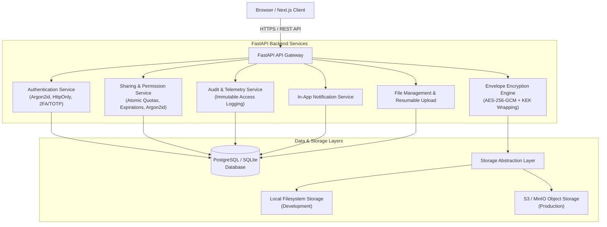

# SecureShare System Architecture

SecureShare is a production-grade, secure file-sharing and encrypted document transfer platform engineered without artificial intelligence or machine learning components. It is built strictly on software engineering, authenticated cryptography, defense-in-depth access control, and robust cloud storage abstractions.

---

## Component Breakdown

### 1. Frontend Client (`frontend/`)
- **Framework**: Next.js 16 (App Router), React 19, TypeScript.
- **Styling**: Tailwind CSS & custom design tokens for dark and light modes.
- **Key Modules**:
  - Landing Page (`/`): Public showcase with one-click live demo session launcher, cryptographic explanation diagrams, feature comparison, and FAQ.
  - Workspace Dashboard (`/dashboard`): Metric cards, storage quota gauges, drag-and-drop file upload, file list, and modal sharing dialogs.
  - File Explorer (`/files`): Categorized directory view with MIME filtering, search, and file actions.
  - Cryptographic Inspector (`/files/[id]`): Detailed view displaying AES-256-GCM parameters, 96-bit nonce, wrapped key envelope size, SHA-256 checksum, live integrity verification, collaborator permissions manager, and file-specific access logs.
  - Share Management (`/shared`): Link administration dashboard with filters (Active, Expired, Revoked, Password Protected), atomic download tracking, and revocation controls.
  - Public Recipient Experience (`/share/[token]`): Zero-knowledge token verification, Argon2id password challenges, and tamper-verified file download streaming.
  - Security & 2FA (`/security`): TOTP authenticator pairing, emergency recovery codes, active session revocation, and password management.
  - Audit Trail (`/access-logs`): Comprehensive system audit log with IP logging, timestamping, action tracing, and failure diagnostics.
  - Notifications Center (`/notifications`): Real-time alerts for downloads, uploads, and security events.

### 2. Backend API Gateway (`backend/app/main.py`)
- **Framework**: FastAPI with Python 3.12, Pydantic, SQLAlchemy 2.0, and Alembic migrations.
- **Middleware**:
  - Strict Cross-Origin Resource Sharing (CORS) restricted to verified frontend origins.
  - Sliding-window in-memory rate limiting across sensitive endpoints (`/api/auth/login`, `/api/auth/register`, `/api/auth/login/2fa`, `/api/shares/{token}/verify`).
- **Standardized Responses**: Explicit HTTP status codes (`200 OK`, `201 Created`, `204 No Content`, `400 Bad Request`, `401 Unauthorized`, `403 Forbidden`, `404 Not Found`, `410 Gone`, `413 Payload Too Large`, `429 Too Many Requests`).

### 3. Cryptographic Engine (`backend/app/encryption.py`)
- **Authenticated Encryption**: Advanced Encryption Standard in Galois/Counter Mode (AES-256-GCM).
- **Envelope Encryption**:
  - Each file upload generates a random 256-bit Data Encryption Key (DEK) and a unique 96-bit Nonce.
  - The plaintext file is encrypted with AES-256-GCM using `AAD = b"secureshare:file:v1"`.
  - The DEK is encrypted under the deployment's Key Encryption Key (KEK) using `AAD = b"secureshare:key:v1"`.
  - Only the wrapped key and ciphertext are persisted; plaintext DEKs are immediately discarded from memory.
- **Tamper Protection**: Any bit modification in the ciphertext or nonce causes AES-GCM tag verification to raise `cryptography.exceptions.InvalidTag`, preventing delivery of corrupted or altered data.
- **Checksum Verification**: SHA-256 checksums are calculated on original plaintext and validated upon download.

### 4. Storage Abstraction Layer (`backend/app/storage.py`)
- Defines a uniform interface:
  - `put(key: str, data: bytes) -> None`
  - `get(key: str) -> bytes`
  - `delete(key: str) -> None`
  - `exists(key: str) -> bool`
- **Adapters**:
  - `LocalStorageAdapter`: Safely stores ciphertext on local storage using 64-character random hex keys (preventing directory traversal).
  - `S3StorageAdapter`: Seamlessly connects to AWS S3, Cloudflare R2, or MinIO object storage without requiring business logic changes.

### 5. Sharing & Permission Engine
- **High-Entropy Tokens**: Sharing links use 32-byte cryptographic random URL-safe tokens (`secrets.token_urlsafe(32)`).
- **Hashed Token Persistence**: Only `SHA-256(token)` is stored in the database. Raw tokens never reside at rest.
- **Atomic Download Quotas**: Concurrency-safe SQL updates (`update(ShareLink).where(downloads < max_downloads).values(downloads = downloads + 1)`) guarantee download caps cannot be bypassed by race conditions.
- **Role-Based Access Control (RBAC)**: Internal file collaborators can be granted `OWNER`, `EDITOR`, or `VIEWER` roles.
