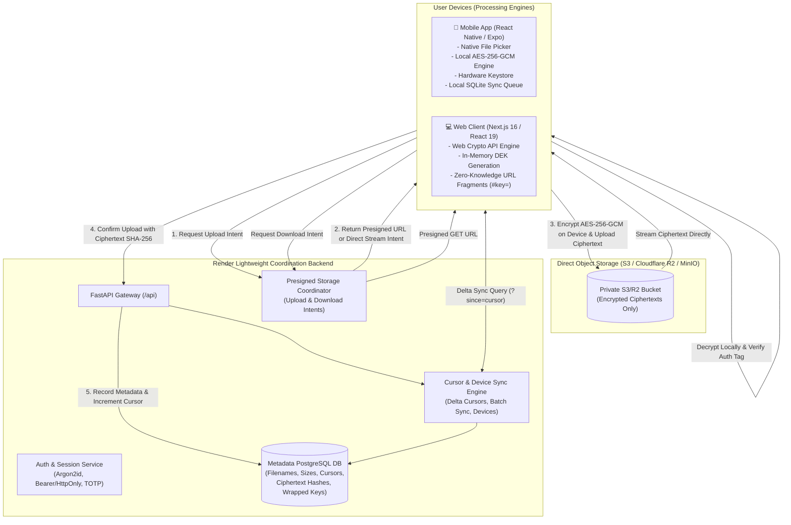

# SecureShare System Architecture: Device-Powered & Mobile-First

SecureShare is a commercial-grade, deterministic, **zero-knowledge** secure file sharing and encrypted document transfer platform engineered for mobile and web.

## Primary Architectural Principle

**ALL FILE PROCESSING POWER DERIVES EXCLUSIVELY FROM THE USER'S DEVICE.**  
Render and the cloud backend function strictly as a lightweight coordination, metadata indexing, authentication, and synchronization hub. Plaintext file contents and unencrypted data keys are never transmitted to, buffered on, or accessible by Render.



---

## Component Breakdown

### 1. Mobile Application (`mobile/`)
- **Technology Stack**: React Native, Expo SDK 52, TypeScript, SQLite, `@noble/ciphers`.
- **Local File Processing**:
  - Native document selection via `expo-document-picker`.
  - In-device chunked SHA-256 hashing and AES-256-GCM authenticated encryption.
  - Generates cryptographically secure 256-bit Data Encryption Keys (DEKs) and 96-bit nonces locally.
- **Hardware Keystore Integration**:
  - Secure hardware-backed storage for device-held keys using `expo-secure-store` (Android Keystore / iOS Secure Enclave).
- **Local-First SQLite Database**:
  - `local_files`: Caches file metadata, offline availability flags, local filesystem paths, and encrypted keys.
  - `sync_queue`: Maintains pending offline uploads, updates, and deletes with priority, attempt counters, and error states.
  - `sync_metadata`: Tracks high-water mark synchronization cursors (`last_sync_cursor`).
- **Resilient Background Synchronization**:
  - Network state monitoring via `expo-network`.
  - Wi-Fi only synchronization setting to respect mobile data limits.
  - Battery-saver mode detection to suspend heavy cryptographic jobs during low-battery conditions.
  - Exponential backoff retry engine for network disruptions.
- **Biometric Security**:
  - App-level biometric lock (Fingerprint / Face Unlock) using `expo-local-authentication`.

### 2. Modern Web Frontend (`frontend/`)
- **Technology Stack**: Next.js 16 (App Router), React 19, TypeScript, Tailwind CSS, Web Crypto API.
- **Local Cryptographic Engine (`frontend/app/lib/crypto.ts`)**:
  - Uses browser native `crypto.subtle` for hardware-accelerated AES-256-GCM.
  - Extracts SHA-256 checksums before encryption.
  - Performs 100% in-browser encryption before uploading to object storage.
  - Performs 100% in-browser decryption upon download, validating the 128-bit authentication tag before triggering browser save.
- **Zero-Knowledge Link Sharing (`frontend/app/lib/downloader.ts` & `/share/[token]`)**:
  - Share links append the raw Data Encryption Key as an anchor hash fragment: `https://secureshare.vercel.app/share/<token>#key=<base64url_key>`.
  - RFC 3986 specifies that URL fragments are **never sent to servers** over HTTP(S).
  - The recipient's browser reads the key directly from `window.location.hash`, requests the encrypted ciphertext from storage, and decrypts the file client-side. Render never learns the key.
- **SaaS Design System**:
  - Linear/Raycast-inspired layout with clean typography, balanced spacing, and subtle borders.
  - Storage telemetry displaying cloud storage vs local device storage.
  - Live cryptographic visualizer with one-click interactive encryption playground.

### 3. Lightweight Render Backend (`backend/`)
- **Role**: Coordination, Metadata Indexing, Access Control, and Authentication.
- **No Heavy File Processing**:
  - Render never runs CPU-intensive compression, OCR, media transcoding, or server-side file decryption.
  - Server resources remain negligible, enabling high scalability on free or micro cloud instances.
- **Storage Intent Endpoints**:
  - `POST /api/storage/upload-intent`: Issues short-lived presigned PUT URLs for direct mobile/web transfer to S3/R2 object storage (or local raw streaming fallback).
  - `POST /api/files/{file_id}/confirm-upload`: Finalizes file metadata once the client completes direct storage transfer.
  - `GET /api/files/{file_id}/download-intent`: Issues presigned GET URLs with short expiration windows for direct ciphertext downloads.
  - `GET /api/storage/raw/{object_key}`: Raw ciphertext streaming endpoint used when running with local storage fallback; streams bytes directly without buffering in memory.
- **Delta Synchronization Engine**:
  - `POST /api/sync/device/register`: Registers mobile and desktop client devices with public keys, device models, and push notification tokens.
  - `GET /api/sync/cursor`: Cursor-based delta synchronization returning changes (`created`, `updated`, `deleted`, `trashed`) since the client's last sync timestamp.
  - `POST /api/sync/batch`: Batch synchronization endpoint allowing mobile clients to push multiple local operations in a single atomic HTTP round-trip.
- **Identity & Access Management**:
  - Argon2id password hashing and RFC 6238 TOTP two-factor authentication.
  - Supports dual session authentication: `Authorization: Bearer <session_token>` for native mobile apps and `Cookie: secureshare_session` for web browsers.

---

## End-to-End Cryptographic Flow

```
1. Mobile / Web Client selects file: "financial_report.pdf" (10 MB)
2. Client generates random 256-bit DEK: k_data = SecureRandom(32)
3. Client computes SHA-256 of original file: H_orig = SHA256(Plaintext)
4. Client encrypts file using AES-256-GCM:
     Ciphertext, Tag = AES_GCM_Encrypt(k_data, Nonce_96, Plaintext, AAD="secureshare:file:v2")
5. Client computes SHA-256 of Ciphertext: H_cipher = SHA256(Ciphertext)
6. Client wraps k_data using device key or KEK envelope.
7. Client calls Backend: POST /api/storage/upload-intent
     Backend returns: { "upload_url": "https://s3.us-east-1.amazonaws.com/...", "object_key": "..." }
8. Client transfers Ciphertext directly to Object Storage via HTTP PUT.
9. Client calls Backend: POST /api/files/{id}/confirm-upload
     Backend verifies object presence and stores metadata (H_orig, H_cipher, Nonce, Tag).
10. Other devices receive metadata change via GET /api/sync/cursor?since=T.
11. Receiving device downloads Ciphertext directly from S3/R2.
12. Receiving device decrypts Ciphertext locally:
     Plaintext = AES_GCM_Decrypt(k_data, Nonce_96, Ciphertext, Tag, AAD="secureshare:file:v2")
     Verify SHA256(Plaintext) == H_orig.
```
