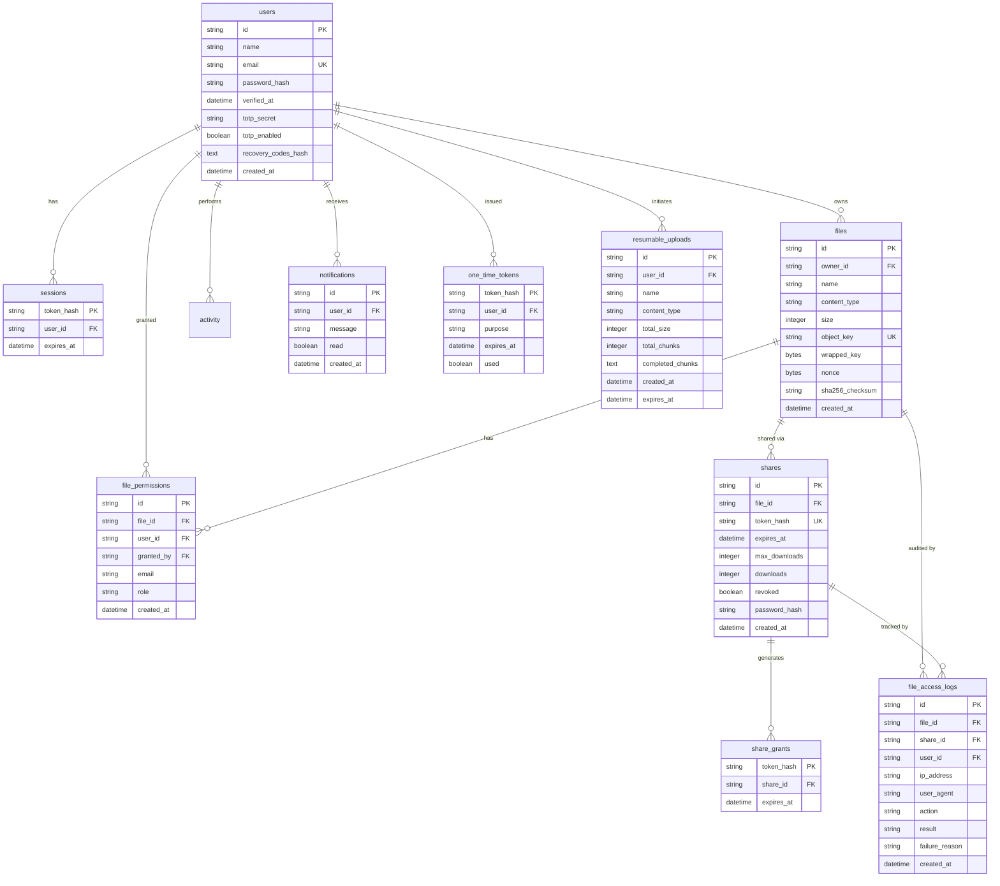

# SecureShare Database Schema Documentation

SecureShare uses PostgreSQL in production and supports SQLite for frictionless local development. The database schema is fully managed using Alembic migrations with forward and backward compatibility checks.



---

## Table Definitions

### 1. `users`
Stores user credentials, verification status, and Two-Factor Authentication (TOTP) configuration.
- `id`: UUID primary key.
- `name`: Display name (2-120 chars).
- `email`: Normalized unique email address.
- `password_hash`: Memory-hard Argon2id hash.
- `verified_at`: Timestamp of email verification (null if pending).
- `totp_secret`: Encrypted Base32 secret for RFC 6238 TOTP authentication.
- `totp_enabled`: Boolean flag indicating if 2FA challenge is required on login.
- `recovery_codes_hash`: JSON-encoded Argon2id hashes of emergency 2FA backup codes.
- `created_at`: UTC timestamp.

### 2. `sessions`
Server-side opaque sessions. The client receives an opaque cookie containing a high-entropy string; the server stores only the SHA-256 hash.
- `token_hash`: SHA-256 digest of the session cookie (primary key).
- `user_id`: Foreign key to `users.id` with `CASCADE` delete.
- `expires_at`: Indexed expiration timestamp.

### 3. `files`
Metadata and cryptographic envelope parameters for stored files.
- `id`: UUID primary key.
- `owner_id`: Foreign key to `users.id` with `CASCADE` delete.
- `name`: Original filename (sanitized to prevent path traversal).
- `content_type`: Verified MIME type (validated against magic bytes).
- `size`: Byte count of original plaintext.
- `object_key`: Random 64-character hex identifier pointing to storage object.
- `wrapped_key`: AES-256-GCM wrapped Data Encryption Key (DEK).
- `nonce`: Unique 96-bit AES-256-GCM initialization vector.
- `sha256_checksum`: SHA-256 hash of original plaintext for integrity verification.
- `created_at`: UTC timestamp.

### 4. `shares`
Access rules and state for revocable, expiring sharing links.
- `id`: UUID primary key.
- `file_id`: Foreign key to `files.id` with `CASCADE` delete.
- `token_hash`: SHA-256 digest of the URL bearer token (unique index).
- `expires_at`: Optional timestamp after which access is denied.
- `max_downloads`: Optional maximum completed downloads limit.
- `downloads`: Atomic counter of completed downloads.
- `revoked`: Boolean flag for immediate manual kill-switch.
- `password_hash`: Optional Argon2id hash for password-protected links.

### 5. `file_permissions`
Role-based collaborator authorization.
- `id`: UUID primary key.
- `file_id`: Foreign key to `files.id`.
- `user_id`: Optional foreign key to `users.id` if registered.
- `granted_by`: User ID of owner who created the permission.
- `email`: Target collaborator email address.
- `role`: Role string (`VIEWER` or `EDITOR`).

### 6. `file_access_logs`
Comprehensive audit trail for compliance and security monitoring.
- `id`: UUID primary key.
- `file_id`: Nullable foreign key to `files.id`.
- `share_id`: Nullable foreign key to `shares.id`.
- `user_id`: Nullable foreign key to `users.id`.
- `ip_address`: Client IP address.
- `user_agent`: Sanitized User-Agent header (truncated to 255 chars).
- `action`: Audit event type (`file.uploaded`, `file.downloaded`, `share.created`, `share.inspected`, `share.verify_success`, `share.verify_failed`, `share.downloaded`, `share.revoked`).
- `result`: Outcome (`success`, `failure`, `denied`).
- `failure_reason`: Diagnostic reason if failed.
- `created_at`: UTC timestamp.

### 7. `share_grants`
Short-lived temporary authorization proof granted after successful password verification.
- `token_hash`: SHA-256 digest of 32-byte grant token (primary key).
- `share_id`: Foreign key to `shares.id`.
- `expires_at`: Expiration timestamp (15 minutes).

### 8. `notifications`
In-app user notifications for file activity and security alerts.
- `id`: UUID primary key.
- `user_id`: Target user foreign key.
- `message`: Text summary.
- `read`: Read state flag.
- `created_at`: UTC timestamp.

---

## Alembic Migration Management

Database migrations are located in `backend/migrations/versions/`:
- `0001_initial.py`: Core tables (`users`, `sessions`, `files`, `shares`, `activity`, `share_grants`, `notifications`, `one_time_tokens`, `resumable_uploads`).
- `0002_permissions_and_logs.py`: Permissions and access logs extension (`file_permissions`, `file_access_logs`, and `sha256_checksum` in `files`).

To apply migrations manually:
```bash
cd backend
python -m alembic upgrade head
```
